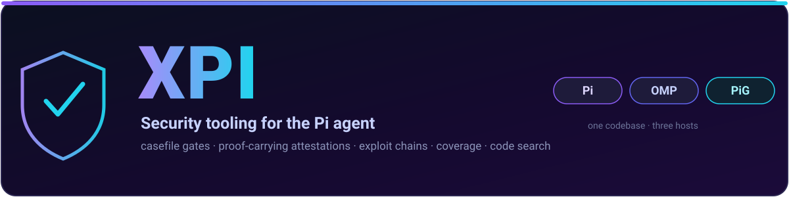
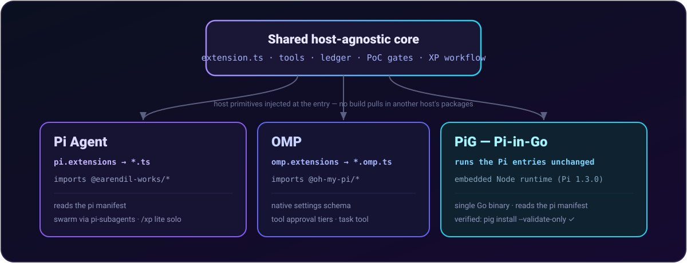
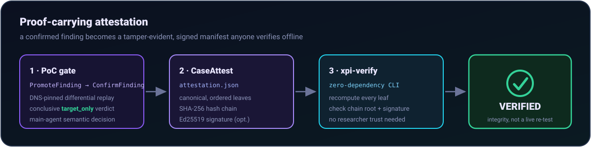

<div align="center">



[](https://www.npmjs.com/package/@xaccefy/pi-xpi)
[](https://www.npmjs.com/package/@xaccefy/pi-xpi)
[](LICENSE)

</div>

## What it is

XPI turns the Pi agent into a security researcher: a case ledger with enforced gates, exploit-technique grounding and web lookup (via the host's research tools), fast code search, and a pipeline that keeps findings honest.

- **Casefile** — hypothesis → investigating → confirmed → reported, with gates at every step
- **Machine-owned PoC gates** — zero exit is necessary but never proof: direct-response findings require nonce-bound body evidence plus a DNS-pinned, conclusive `target_only` replay against an operator-approved control; reflection-capable requests can add a harness-generated target-only canary; only the main agent may make the semantic decision and commit phase 2
- **Exploit chains** — `ChainSuggest` surfaces combinations the model missed
- **Coverage matrix** — machine-checkable "we tested everything" claims
- **Proof-carrying attestations** — `CaseAttest` emits a canonical, hash-chained, Ed25519-signed manifest of a confirmed finding; a triager runs `xpi-verify` to recompute the chain and check the signature without trusting the researcher or re-testing live
- **Code search** — structural AST search (ast-grep) for sinks and call chains, plus built-in grep/find for text

## Install

One codebase, three hosts — a shared host-agnostic core with a thin native entry per host, so no build pulls in another host's packages. (Internals in the [guide](docs/guide.md#hosts-pi-agent-omp-and-pig).)

<p align="center"></p>

| Host | Binary | Install | Notes |
|------|--------|---------|-------|
| **Pi Agent** | `pi` | `pi install npm:@xaccefy/pi-xpi` | `@earendil-works/*`; reads the `pi` manifest |
| **OMP** (`@oh-my-pi`) | `omp` | `omp install npm:@xaccefy/pi-xpi` | native `omp` manifest + settings schema + tool approval tiers |
| **PiG** ([pi-in-go.dev](https://pi-in-go.dev)) | `pig` | `pig install npm:@xaccefy/pi-xpi` | Go port of Pi; runs the Pi entries unchanged in its embedded Node runtime |

Or from a checkout, `./install.sh` auto-detects the host (pi → omp → pig) and also wires subagent dispatch and optional ast-grep structural search:

```bash
./install.sh                       # auto-detect
./install.sh --pi | --omp | --pig  # force a host
./install.sh --pi --no-subagents   # minimal; /xp lite only (no swarm dispatch)
```

All three hosts are verified to load XPI and register its tools (PiG via `pig … --validate-only`, OMP via `omp plugin doctor`).

## Quick start

```
/xp        # toggle bounded swarm XP mode on/off
/xp lite   # explicit single-agent security workflow
/xp swarm  # bounded multi-agent pipeline
```

Use `/xp` for the default bounded swarm workflow, or `/xp lite` for CTFs, focused reviews, and one-target work where dispatch is unnecessary. On Pi, swarm dispatches only `auditor`, `tracer`, `skeptic`, and `chain` via pi-subagents; on OMP it uses the native `task` tool with the same four agent names. Validation, patching, reporting, and `ConfirmFinding` stay with the main agent.

A confirmed case can emit a signed, hash-chained attestation (`CaseAttest`) that anyone verifies offline — no trust in the researcher, no live re-test — with the bundled zero-dependency CLI:

<p align="center"></p>

```bash
xpi-verify path/to/report/<case>.attestation.json
# → recomputes every leaf + the chain root, checks the Ed25519 signature → VERIFIED / FAILED
```

Full tool reference, configuration, attestations, and pipeline docs: **[docs/guide.md](docs/guide.md)** · [docs/attestation.md](docs/attestation.md).

## Packages

| Package | npm |
|---------|-----|
| Umbrella | [`@xaccefy/pi-xpi`](https://www.npmjs.com/package/@xaccefy/pi-xpi) |
| Case ledger | [`@xaccefy/pi-casefile`](https://www.npmjs.com/package/@xaccefy/pi-casefile) |
| Todos | [`@xaccefy/pi-xtodo`](https://www.npmjs.com/package/@xaccefy/pi-xtodo) |

## Develop

```bash
bun install
bun test --isolate
bun run typecheck        # Pi build (excludes the *.omp.ts entries)
bun run typecheck:omp    # OMP entries, after: bun add -d @oh-my-pi/pi-coding-agent @oh-my-pi/pi-tui
```
